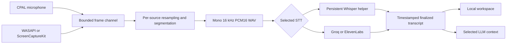

# Architecture

## Workspace map

| Path | Responsibility |
| --- | --- |
| `src/App.tsx` | Dashboard, history, mode editor, settings, onboarding, unlock and backup dialogs, and the overlay route |
| `src/store.ts` | Zustand state; snapshot revision filtering, streaming deltas, progress and error notices |
| `src/bridge.ts` | Tauri invocation/events; a separate, clearly labeled browser UI preview |
| `src/domain.ts` | Presentation-independent search, transcript merge, endpoint validation, and Markdown export helpers |
| `src/types.ts` | Frontend wire types; imports shared seed data |
| `shared/` | Initial settings/modes and pinned local-model download manifest |
| `crates/pluely-core/src/model.rs` | Serialized domain objects, configuration validation, recovery, session context/export |
| `crates/pluely-core/src/audio.rs` | Resampling, speech segmentation, and PCM WAV encoding |
| `crates/pluely-core/src/providers.rs` | Direct transcription requests, OpenAI-compatible chat/SSE, and bounded document selection |
| `crates/pluely-core/src/vault.rs` | Workspace envelope, encryption, passphrase derivation, atomic file replacement |
| `crates/pluely-transcribe` | Persistent local Whisper inference process |
| `src-tauri/src/service.rs` | App-owned state, persistence, OS credentials, cancellation and capture lifecycle coordination |
| `src-tauri/src/commands.rs` | Frontend command handlers and session orchestration |
| `src-tauri/src/capture.rs` | Microphone, platform system audio, and transcription pipeline |
| `src-tauri/src/llm.rs` | Chat orchestration, one-shot screen context, and meeting notes |
| `src-tauri/src/models.rs` | Verified download/offline import and the cached local worker client |
| `src-tauri/src/desktop.rs` | Windows, tray, global shortcuts, startup behavior, appearance, idle stop |
| `native/macos/AudioCapture.swift` | Original ScreenCaptureKit system-audio helper |
| `scripts/` | Target-specific sidecar build and distribution license collection |

The Rust workspace defaults to `pluely-core` so portable tests can run without native desktop dependencies. Native application modules are compiled only for Windows and macOS. A Linux build of the fallback app entry point does **not** validate any of those native modules.

## Application and window ownership

One Rust service owns the workspace. The main window and overlay are views of the same state, rather than independent histories. Tauri's single-instance plugin opens the existing dashboard when another app instance launches. Closing the dashboard hides it; it does not itself end a recording. Tray and shortcuts remain available according to visibility preferences.

The overlay uses `index.html?window=overlay`, has no decorations, remains above normal windows, and supports dragging. The expanded initial size is 690 × 500 logical pixels. Collapse requests a 52-pixel toolbar height; a dedicated Tauri capability authorizes resizing. The minimum width is 420 pixels. Native sizing and mixed-DPI behavior require real-device validation.

Capture exclusion calls Tauri/OS window content protection on both application windows. The selected appearance also controls tray visibility and, on macOS, accessory activation policy. This does not hide an OS process or guarantee exclusion from every recording method. No-focus mode changes overlay focusability and disables its text field; quick prompts and global assistance remain the intended inputs in that mode.

No recording starts on launch. A Start action, tray action, or configured shortcut explicitly starts a session. The automatic stop checks every 30 seconds and ends an active recording after ten minutes without speech-processing or assistant activity. This heuristic is not calendar or call detection.

## Recording lifecycle

1. Check that history protection is configured and unlocked, that another session is not active, and that the selected STT provider has its prerequisite key/model/helper.
2. Acquire the async lifecycle lock. Recheck for another active meeting, because dashboard and tray actions can race.
3. Initialize microphone and system capture on blocking threads. Permission/device failure returns an error before publishing a recording session.
4. Persist a `recording` session with a stable ID and set `activeSessionId`. Store the capture handle and launch the pipeline for that session ID.
5. Pause stops capture and saves accumulated elapsed time. Remaining STT work may still finish. Resume creates fresh capture devices and a new pipeline at the saved timestamp offset.
6. End stops capture, clears the active ID, marks the meeting `processing`, hides the overlay, and lets pending STT work drain. Once drained, the meeting becomes `ready`; notes generation starts if a language model was configured.
7. Resuming an old meeting reuses its ID and timestamp offset. A meeting still processing cannot be resumed.

Elapsed time excludes paused periods. Starting a second session while previous notes finish is allowed because background jobs carry explicit session IDs. Deleting an active meeting is rejected; deleting a completed meeting cancels its associated chat, notes, and audio tokens. Late jobs find their target by ID and cannot recreate a deleted session.

STT configuration is captured when each pipeline starts. Changing its provider/model during a recording takes effect on the next capture start/resume; already queued segments retain their original provider choice. LLM configuration is read for each new assistance/notes request. Pause stops acquiring new audio, but previously captured segments can still finish transcription while paused.

`recording`, `paused`, `processing`, `ready`, and `error` are domain statuses. Recovery after restarting clears the active session ID and pending flags, preserving finalized text rather than pretending recording continued while the app was closed. Forced termination can still lose work that had not reached a successful persistence operation.

## Capture and transcription path

Microphone input is downmixed to mono and labeled `me`; system audio is labeled `them`. These labels describe sources, not verified speaker identities. Multiple remote speakers remain one source. There is no named diarization or acoustic echo cancellation. Speakers can feed remote audio back into the microphone, so a headset is preferable for evaluating source separation.

Windows uses the default render endpoint in shared WASAPI loopback mode. macOS uses a separate Swift process producing 48 kHz mono PCM16; status JSON travels on stderr and audio on stdout. The helper exits when its parent disappears. Capture does not require a virtual audio driver. Default devices are chosen when capture starts; there is no live device selector or seamless hot-swap implementation.

Rust maintains separate segmenters for microphone and system audio. Resampling uses stateful linear interpolation. Segmentation is independently implemented energy VAD: 20 ms analysis frames, 300 ms pre-roll/tail, a minimum 200 ms voiced duration, and a hard 20-second segment bound. It is not Cluely's Silero detector. Music, low voices, noise, overlapping speech, and hardware gain need benchmarking before accuracy or parity claims.

The frame channel holds at most 128 frames. A pipeline permits four concurrent provider jobs and bounds outstanding jobs at 20, with at most the final per-source flush added during shutdown. The single cached local worker serializes local inference. When processing cannot keep up, input/segments may be dropped and a visible notice reports possible transcript gaps. No hidden cloud fallback occurs. Provider errors remove unfinished placeholder rows and report the error; raw failed audio is not retained for retry.

Transcripts are segment-final results, not word-by-word streaming hypotheses. Latency includes the speech boundary, provider/inference time, and queue wait. Completion order can differ from spoken order; finalized rows are sorted by `atMs`. A finalized row cannot be overwritten by a stale partial. End Session allows queued work to finish; Quit can interrupt pending work and must not be treated as equivalent to a fully drained end.

## State, revisions, and persistence

The wire snapshot contains `settings`, `sessions`, `modes`, `activeSessionId`, `selectedModeId`, and `revision`. JSON field names use camelCase. IDs are UUID strings except stable built-in mode/model IDs. `startedAt`/`endedAt` are RFC 3339 strings; transcript timestamps and durations are milliseconds.

`Service::mutate` clones the current snapshot under its mutex, applies a mutation, increments its revision, persists if requested, then replaces and emits the new snapshot. A failed save does not publish that candidate mutation as durable state. Streaming chat deltas update memory/revision and emit a smaller event; finalization persists the resulting text. A crash during a response can lose deltas since the last durable snapshot.

The frontend ignores older snapshots/deltas and does not append a delta to a message that no longer exists. Native authoritative snapshots can restore state after intermediate events. The browser preview has its own in-memory snapshot, cannot record or call providers, and cannot securely store credentials. Example meetings appear only after an explicit labeled action and are never evidence of native recording.

## AI, documents, and notes

A meeting references a mode ID. Modes contain live instructions, notes instructions, and extracted document text. TXT/Markdown/JSON/CSV must be UTF-8; PDF import extracts text and does not perform OCR. Files are limited to 20 MB, extracted content to 1 MB, and empty text is rejected. File import stages content for a mode; saving that mode commits the edited document collection.

Live context includes the last 36,000 bytes of transcript, up to eight previous chat messages capped at 6,000 bytes each, and up to eight document passages within a 14,000-byte budget. Document ranking counts prompt-word matches; it is a lexical retrieval baseline, not an embedding database. All byte truncation preserves UTF-8 boundaries. These limits are byte budgets rather than model-specific token guarantees.

Screen context is a single primary-display screenshot captured when asking, only when requested and the selected model is configured for images. Pluely windows are temporarily hidden and restored around capture. The image is reduced to at most 1920 × 1920 and encoded as JPEG quality 76, then sent as an OpenAI-style image input. Images are not stored in history. Window/display selection, OCR-only mode, and periodic background screenshots are not implemented.

Notes process a finalized transcript after the meeting, splitting long transcripts into 36,000-byte parts, with at most 32 parts. Multiple parts are summarized before a final notes request. A mode's notes instructions guide output. This still depends on provider context limits and model quality. The app requests factual notes and uncertainty handling; it cannot guarantee a model never invents information.

Chat/notes jobs use cancellation tokens. A newer job replaces its token; old canceled notes do not overwrite a new generation, and canceled streaming callbacks stop emitting text. Automatic notes and live assistance use the user's configured model, not a Pluely server. See [provider contracts](PROVIDERS_AND_PRIVACY.md) and [IPC](IPC.md).
